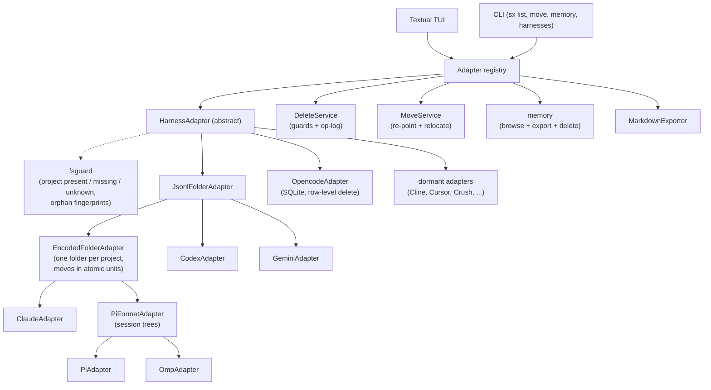

# sx — session explorer for AI coding harnesses

A terminal TUI that gathers the chat sessions every AI coding harness leaves on
your machine — **Claude Code**, **Codex**, **Gemini CLI**, **Pi**, **Oh My Pi**,
and more — into one browsable, groupable, *deletable* view. Think of it as a
terminal-native alternative to Claude Code UI, covering every harness at once.

> **Status:** functional. Browsing, search, grouping, moving a project to a new
> directory, permanent deletion with Markdown export, and orphan cleanup all work
> across Claude, Codex, Gemini, opencode, Pi, and Oh My Pi.

## Why

Each harness scatters sessions in its own format and location: Claude under
`~/.claude/projects/<encoded-cwd>/`, Codex in a date tree under
`~/.codex/sessions/`, Gemini as mutation logs under `~/.gemini/tmp/<hash>/`,
opencode as rows in a shared SQLite database, and Pi and Oh My Pi as branching
session trees under `~/.pi/agent/sessions/` and `~/.omp/agent/sessions/`. Over
time these pile up alongside
orphaned folders pointing at projects you deleted long ago. `sx` reads them all,
lets you scroll any transcript, and permanently removes the ones you no longer
want.

## Features

- **Unified browser** — sessions grouped by harness, then by project.
- **Scrollable transcripts** — normalized rendering across every harness.
- **Branched sessions** — Pi and Oh My Pi keep every retried or edited prompt in
  the same file. Press `t` to switch between the current branch (with a count of
  what the others hold), the current branch followed by every other branch, and
  the whole tree in the order it was written; the view you pick carries over to
  the next session you open. `e` asks which of the three to export, and the
  export offered before a delete starts on the whole tree.
- **Move a project** — relocated a repo? Re-point its sessions at the new
  directory in every harness at once, or have `sx` move the directory too.
  Reversible, unlike deletion, with the exceptions listed under
  [Moving a project](#moving-a-project).
- **A delete that finishes the job** — a Claude session takes every artifact
  Claude wrote for it: sidecars, task and environment state, security state,
  scratchpads and prompt-history rows. A Pi or Oh My Pi session takes what that
  harness's own delete removes.
- **Project memory browser** — read, archive and remove the notes Claude Code
  keeps *between* sessions, which no session delete will ever touch.
- **Orphan detection** — finds session folders whose project is definitely
  gone, empty folders, header-less fragments, stray temp files and state left
  behind by deleted sessions, reports *why* each is flagged, and checks each one
  again before deleting it.
- **Permanent delete with guardrails** — dry-run preview, typed confirmation
  for bulk operations, a path allowlist, an active-session guard that is checked
  again when you confirm, and an append-only deletion log. No accidental
  `rm -rf`.
- **Pre-delete Markdown export** — optionally archive a transcript to Markdown
  before removing it (also available as a standalone export action).
- **Forward-looking** — harnesses you have not installed yet appear grayed out
  and light up the moment their session store shows up on disk.

## Supported harnesses

| Harness | Status | Store |
|---|---|---|
| Claude Code | ✅ verified | `~/.claude/projects/<encoded-cwd>/<id>.jsonl` (or `$CLAUDE_CONFIG_DIR`) |
| Codex | ✅ verified | `~/.codex/sessions/YYYY/MM/DD/rollout-*.jsonl` |
| Gemini CLI | ✅ verified | `~/.gemini/tmp/<hash>/chats/session-*.jsonl` |
| opencode | ✅ verified | `~/.local/share/opencode/opencode.db` (SQLite) |
| Pi | 🔬 from source | `~/.pi/agent/sessions/--<path>--/<time>_<id>.jsonl` (or `$PI_CODING_AGENT_DIR`) |
| Oh My Pi | 🔬 from source | `~/.omp/agent/sessions/<folder>/<time>_<id>.jsonl` (profiles, `$PI_CODING_AGENT_DIR`, XDG) |
| Qwen Code | 🔎 dormant | Gemini-fork layout |
| Continue | 🔎 dormant | `~/.continue/sessions/*.json` |
| Goose | 🔎 dormant | `~/.local/share/goose/sessions/` |
| Cline | 🧩 dormant | `~/.cline/data/workspaces/<id>/` |
| Cursor | 🧩 dormant | `~/.cursor/` (SQLite) |
| Crush | 🧩 dormant | SQLite |

✅ verified on a real machine · 🔬 fully supported, built from the harness's
source code (no real sessions sampled yet) · 🔎 format known · 🧩 needs probing
once installed

### Relocated Claude installs (`CLAUDE_CONFIG_DIR`)

Claude Code lets you move its configuration home with the `CLAUDE_CONFIG_DIR`
environment variable. `sx` follows it, resolving the store exactly as the
harness does — export the same value and every path below shifts with it:

```bash
export CLAUDE_CONFIG_DIR=/path/to/config
sx harnesses      # confirms which config home sx is reading
```

Three details worth knowing, all matching Claude Code's own behavior:

- **The value is used as-is and must be absolute.** There is no tilde
  expansion, and a relative path is ignored with a warning rather than resolved
  against the working directory — that would make the delete allowlist depend
  on where you launched `sx` from. The home directory and `/` are refused too.
- **`.claude.json` moves *into* it.** With the variable set the file is
  `$CLAUDE_CONFIG_DIR/.claude.json`; without it, `~/.claude.json` — beside
  `~/.claude`, not inside it.
- **The `/private/tmp/claude-<uid>` scratchpad does not move**, because Claude
  derives it from your uid rather than the config home.

If the directory does not exist, Claude is reported as not installed. `sx` never
falls back to `~/.claude`, so it cannot quietly read — or delete from — a store
you did not point it at.

### Relocated Pi and Oh My Pi stores

Pi and Oh My Pi both read `PI_CODING_AGENT_DIR`, and `sx` follows it the way each
of them does:

- **Pi reads the value as Pi does.** Nothing is trimmed. `~/x` and `~//x` are
  joined onto your home directory the way Node's `path.join` joins them, and a
  `file://` URL becomes the path it names. A value that is still relative — a
  leading space is kept, so it makes one — is ignored with a warning rather than
  resolved against the directory `sx` was started in. So are a `file:` URL `sx`
  cannot read exactly as Pi does, the home directory (`~` included) and `/`;
  `sx` then reads `~/.pi/agent`.
- **Oh My Pi takes the value as it is.** There is no `~` expansion, so `~/x` is
  a relative path and is ignored with a warning, like the home directory and
  `/`. Oh My Pi reads the variable only from its environment, never from a
  `.env` file, and ignores it while a profile is active.
- **Oh My Pi profiles, `PI_CONFIG_DIR` and XDG directories are followed.** A
  profile — `OMP_PROFILE`, or `PI_PROFILE` when `OMP_PROFILE` is not set at all
  — moves the store to `~/.omp/profiles/<name>/agent/`. `PI_CONFIG_DIR` renames
  `~/.omp`: it is a directory name, joined onto your home directory even when
  it starts with `/`. Unless `PI_CODING_AGENT_DIR` moved the agent directory, an
  `$XDG_DATA_HOME/omp` that already exists takes over the sessions, and an
  existing `$XDG_STATE_HOME/omp` the memories (under a profile, each is
  `…/omp/profiles/<name>`); the session leases follow `$XDG_STATE_HOME/omp`
  either way. Other profiles' sessions are not listed; `sx harnesses` says when
  some exist.
- **Oh My Pi's `.env` files count too.** At startup Oh My Pi fills unset
  variables from `.env` files, the first file to set one winning. `sx` reads
  `<agent dir>/.env`, `<config root>/.env` and `~/.env` the same way, for the
  variables that move what it reads: `PI_CONFIG_DIR`, `OMP_PROFILE`,
  `PI_PROFILE`, `XDG_DATA_HOME`, `XDG_STATE_HOME`, `PI_TEST_SESSION_OWNERS_DIR`,
  `PI_TEST_RUNTIME` and `PI_CODING_AGENT_SESSION_DIR`. It parses them as Bun's
  `util.parseEnv` does, Bun being the runtime Oh My Pi runs on, and the store
  location follows that reading. It also parses them as Node's `util.parseEnv`
  does. Where the two readings differ on one of those variables (`KEY: value`,
  `KEY` with `=value` on the next line, a byte-order mark, `export<TAB>KEY`, a
  carriage-return line break, `=KEY=v`), `sx` cannot be sure what Oh My Pi
  makes of the line, so every lease counts as unknown, and every session as
  open, with a warning. Oh My Pi reads its working directory's `.env` first, so
  when `sx` checks a session's lease it reads the `.env` in that session's
  project directory as well; a disagreement there makes only that project's
  sessions unknown, with no warning. A `.env` file `sx` cannot read the way Oh
  My Pi does (larger than 1 MiB, not a regular file, or one `sx` may not open)
  leaves it unable to tell where the leases are too: every session counts as
  open for one of the three files above, that project's sessions for a
  project's `.env`. `PI_TEST_SESSION_OWNERS_DIR`, which moves the lease
  directory, is honored wherever it is set. So is `PI_TEST_RUNTIME=1`, which,
  with no lease directory set, moves it to
  `<tmpdir>/omp-test-session-owners-<uid>` as Oh My Pi does; `sx` watches that
  directory for a held lease in any case.
- **A store both harnesses can reach belongs to one of them.** With an absolute
  `PI_CODING_AGENT_DIR` and no Oh My Pi profile, both resolve to the same agent
  directory. It is Oh My Pi's when it carries Oh My Pi's marks: `agent.db`,
  `history.db`, `models.db`, `terminal-sessions`, `blobs` or an `omp-*.log` in
  the agent directory, or, in a sample of its project folders, a transcript or
  crash backup that starts with Oh My Pi's title slot, or an artifacts folder
  named for a transcript beside it. A file name alone, a backup's or a lock
  file's, is not evidence: a copy you made yourself can be named like one.
  Otherwise the store is Pi's. The other harness lists, moves and deletes
  nothing there; `sx harnesses` and the TUI show it as "store belongs to Oh My
  Pi" (or Pi), and `sx harnesses` says why. Pi applies the same test to its
  default `~/.pi/agent`, so a Pi store Oh My Pi has written to is left to Oh My
  Pi, and its sessions are listed only if Oh My Pi reads that directory.
- **Custom session directories are not followed yet.** `--session-dir`,
  `PI_CODING_AGENT_SESSION_DIR` and Pi's `sessionDir` setting send sessions to a
  directory `sx` does not read. `sx harnesses` warns when the variable is set
  for either harness, or the setting is in Pi's global settings, because those
  sessions are not listed. The `--session-dir` flag leaves nothing `sx` can see.
- **Archived Oh My Pi sessions are left alone.** `omp gc` moves cold sessions,
  compressed, to `archive/sessions/` beside the sessions directory, where Oh My
  Pi itself no longer lists them. `sx` doesn't list them either and never moves
  or deletes anything there. A project folder that still holds session data
  `sx` cannot show — a backup without its transcript, an archive, an archived
  session's artifacts, an unsent draft — is never offered whole for cleanup.
  Deleting a session that also has an archived copy keeps the artifacts folder
  the archive still uses, and such a session is not moved. `sx harnesses` says
  when archives exist.
- **Files `sx` does not recognize are listed, never touched.** A `.jsonl` file
  in a project folder that `sx` cannot read, or in which it finds no session
  header, is listed under "(unknown project)" as
  `(unrecognized format) <file name>`. It can be browsed as far as it parses,
  but it is never deleted, moved or offered for cleanup; `sx harnesses` counts
  such files. The exception is the debris these harnesses leave behind, offered
  for cleanup as a fragment: an empty file, or one whose first line is an entry
  the harness writes. For Oh My Pi, the file must also carry Oh My Pi's own
  `<time>_<id>.jsonl` name. Only the first line counts, so a header-less file
  whose first line is damaged (a session whose header line was cut, say) is
  kept as unrecognized rather than offered as debris.

```bash
sx harnesses      # where each store was found, plus any warnings
```

## Run it

You need [`uv`](https://docs.astral.sh/uv/). sx runs on Python 3.15 or newer, and
uv downloads it automatically if you don't have it. Pick one of the two ways below.

### Option A — run straight from GitHub, no install (`uvx`)

`uvx` fetches, builds, and runs `sx` in a throwaway environment — nothing is
added to your PATH:

```bash
uvx --from git+https://github.com/junxit/agentic-session-explorer.git sx
```

Typing that every time is a mouthful, so add an `sx` alias to your shell. The
alias also sets `SX_NO_UPDATE_CHECK=1`, because `uvx` already pulls the latest
build — the in-app "update available" prompt would be redundant here.

**zsh** — append to `~/.zshrc`:

```bash
alias sx='SX_NO_UPDATE_CHECK=1 uvx --from git+https://github.com/junxit/agentic-session-explorer.git sx'
```

**bash** — append to `~/.bashrc` (Linux) or `~/.bash_profile` (macOS):

```bash
alias sx='SX_NO_UPDATE_CHECK=1 uvx --from git+https://github.com/junxit/agentic-session-explorer.git sx'
```

**fish** — append to `~/.config/fish/config.fish`:

```fish
alias sx 'env SX_NO_UPDATE_CHECK=1 uvx --from git+https://github.com/junxit/agentic-session-explorer.git sx'
```

Then reload (`source ~/.zshrc`, etc.) and run `sx`, `sx list`, `sx --version` —
arguments pass straight through the alias.

`uvx` caches builds, so a plain run may reuse a recent one. To force the newest
commit, add `--refresh` to the alias's command, or pin a released tag with
`...explorer.git@v0.2.0`.

### Option B — install as a tool (recommended for regular use)

This puts a persistent `sx` on your PATH:

```bash
uv tool install git+https://github.com/junxit/agentic-session-explorer.git
```

(From a local clone, `uv tool install .` works too.)

**Upgrade:**

```bash
uv tool upgrade sx
# or force the very latest commit on main:
uv tool install --force git+https://github.com/junxit/agentic-session-explorer.git
```

If `sx` was installed under Python 3.13 or 3.14, `uv tool upgrade sx` stops with
"the current Python version … does not satisfy Python>=3.15". Move the tool to
3.15 once; plain upgrades work again after that:

```bash
uv tool upgrade sx --python 3.15
```

**Uninstall:**

```bash
uv tool uninstall sx
```

When you run an installed `sx` interactively, it checks GitHub **at most once a
day** for a newer release and prints a one-line notice (the TUI shows a toast).
The check is cached, times out fast, fails silently, and never blocks startup.
Turn it off with `--no-update-check` or by exporting `SX_NO_UPDATE_CHECK=1`.

## Usage

```bash
sx              # launch the interactive TUI
sx list         # list every discovered session as plain text
sx move         # re-point a project's sessions at a new directory
sx memory       # list, export or delete a project's memory
sx harnesses    # show all known harnesses and their status
sx version      # show the installed version and check for a newer one
sx update       # show (or, with --run, execute) the upgrade command
```

### Keys (in the TUI)

| Key | Action |
|---|---|
| `↑`/`↓` or `j`/`k` | Move the selection |
| `enter` | Open the highlighted session's transcript |
| `g` / `G` | Jump to top / bottom of a transcript |
| `b` | Cycle grouping: **project → date → recency** |
| `t` | For a branched session, cycle the view: **current branch → + other branches → whole tree** |
| `/` | Filter by title or project (live) |
| `e` | Export the highlighted session to Markdown (a branched session asks which view first) |
| `n` | Browse project memory (read, export, delete) |
| `m` | Re-point this project's sessions at a directory you already moved |
| `M` | Move the project directory itself, then re-point its sessions |
| `d` | Permanently delete the highlighted session (with preview) |
| `o` | Open the orphan-cleanup screen |
| `r` | Re-scan all harness stores |
| `q` | Quit |

A session written within the last 90 seconds — or an Oh My Pi session whose
lease is held or cannot be checked — is flagged `● LIVE`; deleting one requires
typing `DELETE` to confirm. Liveness is checked again when you confirm: a
session that became live while the dialog was open is not deleted, and pressing
`d` again asks for the phrase. Deleting every orphan, or one orphan that removes
more than one path, requires typing `DELETE <n>`. Exports default to
`./session-exports/` and never overwrite an existing file. Every deletion is
appended to `./sx-deletions.log` (set `SX_LOG_FILE` to keep one log across
directories).

## What a delete actually removes

A session is more than its transcript. Deleting one removes every artifact the
harness wrote *for that session*:

| Artifact | Where |
|---|---|
| Transcript | `projects/<encoded-cwd>/<session-id>.jsonl` |
| Sub-agent transcripts, tool results | `projects/<encoded-cwd>/<session-id>/` |
| File-history, environment and task state | `~/.claude/{file-history,session-env,tasks}/<session-id>/` |
| Security-warning state | `~/.claude/security/security_warnings_state_<session-id>.*` |
| Scratchpad | `/private/tmp/claude-<uid>/<encoded-cwd>/<session-id>/` |
| Prompt-history rows | `~/.claude/history.jsonl`, `~/.codex/history.jsonl` |

Every one of those paths is *built* from the session id rather than searched
for, so there is no pattern that could widen onto a neighbor.

Pi and Oh My Pi each remove what the harness's own delete removes. For Pi that
is the session's transcript and nothing else. For Oh My Pi it is the
transcript, its artifacts folder (tool output and sub-agent transcripts) and
every `<transcript>.*.bak` backup, plus any rewrite temp file it abandoned more
than five minutes ago. The backups go first, and the delete stops at the first
thing it cannot remove, so a backup never outlives its transcript: Oh My Pi
would restore the session from it. Nothing is deleted while the transcript
itself is missing, since Oh My Pi may be in the middle of rewriting it. The lock
files beside a transcript are never removed, so an emptied folder can linger
holding only those. Oh My Pi's shared stores (`history.db`, `stats.db`, pins
and the content-addressed `blobs/`) are left to Oh My Pi, as its own delete
leaves them. A session whose format version `sx` does not know, or whose Oh My
Pi title line is not 256 bytes, is refused rather than guessed at. So are the
sessions Oh My Pi (or one of its sub-agents) is writing, and those `sx` cannot
check, which on Linux means every Oh My Pi session (see [Safety](#safety)), and
for both harnesses a session whose project folder is a symbolic link. If a
delete removes some paths but refuses others, the TUI names the paths that
stayed.

Orphans are checked again at deletion, for every harness. Each one is
fingerprinted when the orphan screen lists it, and anything that changed since,
was written in the last 90 seconds, or no longer lies inside the store is
refused; then the harness asks its own question again (is the project still
gone, is the folder still empty, is the session still deleted?). An empty Pi
project folder is offered only once nothing in it has been written for 24
hours, because Pi creates it as soon as it starts in a project, and its listing
warns that a Pi running in that project fails its next prompt once the folder
is gone. Orphan confirmations show each harness's warning about what it may
have open, as session deletes do. The delete is limited to the paths the
confirmation previewed as removable, each still checked again: a path it showed
as refused stays refused even if the reason lapses while you type the phrase
(the 90-second window runs out, say), for a single orphan and for deleting every
orphan alike. Whatever stays is reported: the toast names it with its reason,
the op-log records it, and the orphan keeps its row, narrowed to what stayed.
When you delete every orphan, the dialog lists the paths that will be refused
inside otherwise deletable orphans, and says how many orphans it does not list.

Claude's other scratchpads under `/private/tmp/claude-<uid>` are never offered
as orphans. That directory follows your user id, not the Claude config home, so
every Claude config on the account (another `CLAUDE_CONFIG_DIR`, another `HOME`)
writes its sessions' scratchpads there, and a scratchpad whose session one
config does not know may belong to another config's session, idle or open. A
deleted session's own scratchpad still goes with it; macOS clears the rest of
`/private/tmp` when it restarts. Claude's other per-session artifacts (file
history, environment and task state, security state) are offered as stale only
when every project folder could be read, so a session out of sight never makes
its own artifacts look abandoned. A permission error counts as out of sight, and
so does a `projects` store or a project folder behind a link that dangles (to a
volume that is not mounted, say) or that leads to something other than a
directory. The same check runs again when the delete happens.

**Project memory is deliberately not in that list.** A harness writes memory to
outlive the conversation that produced it, so ending one conversation must not
end the memory. Every delete preview says how many memory files the project has
and that they are being kept. When you delete the **last** session for a project
— across every harness, not just one — the confirmation offers an extra,
**unticked** checkbox to remove the project's own state as well, and the preview
lists what it would remove, per harness, path by path: Claude's project folder
(its memory included), `~/.claude.json` settings entry (trust, `allowedTools`,
MCP servers) and prompt-history rows, but not the project's scratchpad folder,
which other Claude configs' sessions may share; Gemini's project directories
and its registry and folder-trust entries; Pi's project folder, once nothing in
it has been written for 24 hours; Oh My Pi's project folder and memory folder.
Right before removing any of it, `sx` counts the project's sessions again from
a fresh scan of every harness, and Pi and Oh My Pi check their folders again.
If a session has appeared, or the session's transcript was not deleted, the
project state stays.

Artifacts `sx` deliberately leaves alone, because the link is too weak to delete
on: `~/.claude/plans/*.md` (referenced only by filename inside prose),
`~/.claude/paste-cache/*.txt` (hash-named; most appear in no transcript), and all
global config, credentials and plugins.

## Project memory

Memory has no place in the session tree — it belongs to a directory, not a
conversation — so it gets its own view. Press `n`, or from the shell:

```bash
sx memory                                  # every project's memory
sx memory --project ~/src/proj             # just one project's
sx memory --project ~/src/proj --export ./archive
sx memory --project ~/src/proj --delete --dry-run
```

Each document is listed with its type (`user`, `feedback`, `project`,
`reference`), its size, and **the session that wrote it** — memory records an
`originSessionId`, so `sx` can tell you when a memory has outlived the
conversation it came from and shows those as `(deleted)`.

The browser reads Claude Code's memory. Oh My Pi keeps a memory folder per
project too; `sx` moves it with the project and offers it with the project's
last session (see above), but does not list it here.

## Moving a project

When you relocate a project directory, every harness keeps pointing at the old
path. `sx` shows those sessions grouped under a directory that no longer exists,
flags them as orphans, and the only thing it used to offer was deletion.

Two keys fix that, and `sx move` does the same from the shell:

```bash
# the directory has already been moved by hand — just re-point the sessions
sx move --from ~/src/old-place/proj --to ~/src/new-place/proj --dry-run
sx move --from ~/src/old-place/proj --to ~/src/new-place/proj

# nothing has moved yet — move the directory too, then re-point the sessions
sx move --from ~/src/old-place/proj --to ~/src/new-place/proj --relocate
```

One move covers **every** harness holding sessions at that path. What each of
them needs is different:

| Harness | What a move changes |
|---|---|
| Claude Code | Re-points the `cwd` recorded throughout each transcript, then moves the project folder to the name the new path encodes to — carrying `memory/` and every session's `<session-id>/` sidecar. A folder that also holds the sessions of a colliding path (two paths that encode alike) stays put, and the moving sessions leave it one by one, each with its sidecar |
| Codex | Re-points the `cwd` in the `session_meta` and every `turn_context`; files stay in their date tree |
| Gemini CLI | Rewrites the `.project_root` marker and re-keys `~/.gemini/projects.json` |
| opencode | Updates the session's `directory` and `path` columns, and its workspace |
| Pi | Re-points the `cwd` in the session header and moves the transcript to the folder the new path encodes to (the whole folder, when nothing in it has to stay); forks that link to a moved transcript by path are re-pointed at its new location |
| Oh My Pi | The same, with the header changes Oh My Pi's own move makes: the old location is added to `previousSessionFiles`, and the new directory is dropped from `additionalDirectories` (the list goes once it is empty). A session's artifacts folder and backups move with it, or nothing of it moves; `sx` moves the backups on purpose, so Oh My Pi cannot restore the session in the old folder. Lock files stay where they are. The project's memory folder moves too, ahead of the sessions, unless another directory's sessions share it, some of the project's sessions stay behind, or it was written in the last 90 seconds. A folder holding backups, drafts or archives that no transcript in it accounts for moves session by session. A session whose lease Oh My Pi holds, or that `sx` cannot check, is refused |

A few properties worth knowing:

- **It runs in all-or-nothing units.** For Claude, Pi and Oh My Pi, which name
  each project's folder after its path, a move is cut into units — a whole
  folder, or one session's transcript with its sidecars — and each unit's
  rewrites and renames succeed together or are put back (Ctrl-C included) and
  reported as refused. So a transcript is not left re-pointed in a folder named
  for its old path, where the harness cannot see it. Planning accounts for
  folders that earlier units of the same move create, and each unit is checked
  again right before it runs. A folder whose destination appeared in the
  meantime is merged into it entry by entry, never nested inside it; nothing
  is moved into a destination folder that is a symbolic link; and a rename that
  would cross file systems is refused rather than done as a copy. Anything that
  cannot be put back is reported, and re-running the move finishes it. Pi fork
  links of the units that finished are re-pointed even when the move is
  interrupted or fails part-way.
- **A move that only changes letter case works.** On a case-insensitive file
  system (APFS, by default), `/x/App` to `/x/app` renames the project's folder
  in place.
- **Re-running finishes an interrupted move.** Run the same `sx move` again: it
  picks up the sessions an interrupted move left re-pointed but not yet
  relocated, and Oh My Pi memory it left behind, even when no session is left
  to move. For Pi and Oh My Pi it also removes the second name a crash can
  leave on a transcript, between linking it at its destination and unlinking
  its old name. Whenever a Pi session takes part in the re-run, even with
  nothing left to relocate, it re-points fork links an interrupted run left
  dangling. One case stays unrepaired: links left by a run killed outright
  after its last relocation, when no Pi session is left under the old path.
- **Every step is logged.** The op-log records `move_started` with the whole
  plan before anything changes, one `move_unit` record as each unit finishes or
  is refused, with a `status` of `done`, `partial`, `refused` or
  `nothing to do`, and a closing `move_sessions` record with its `status`
  (`finished`, or `interrupted` after Ctrl-C) and `relocated`: where each
  transcript actually ended up, even when a later step of the same move carried
  it again. After a Ctrl-C, the records say what the move had done by then,
  including the Pi fork links it re-pointed on its way out.
- **`sx move` exits 1 when anything was refused**, even if the rest moved, and
  `sx move --dry-run` exits 1 when its preview shows anything that would be
  refused (0 for a clean preview), so a script can tell before and after.
- **It is reversible.** Running the inverse move puts every transcript `sx`
  rewrote back byte for byte, and the op-log records both endpoints so the old
  path is still readable afterwards. The exceptions:
  - Oh My Pi's session header. Like Oh My Pi's own move, every move adds the
    transcript's previous location to `previousSessionFiles` and drops the new
    directory from `additionalDirectories`, so moving back leaves both
    locations listed and does not bring a dropped entry back.
  - A merge. If the destination already held sessions, the inverse move takes
    those along too; the plan says so.
  - A line `sx` had to write whole (one with a duplicate key, say; see
    [Safety](#safety)), and a last line that had no newline, which gains one.
  - Registries outside the session files. `--claude-config`'s `~/.claude.json`
    and Gemini's `~/.gemini/projects.json` are re-keyed back, but each is
    re-serialized and the re-keyed entry ends up last, so their bytes are not
    restored.
- **Only the structural field is touched.** A path mentioned inside tool output
  or your own prose is historical record and is left exactly as written.
- **Subdirectories come along.** A session recorded in `proj/docs` moves with
  `proj`; a sibling named `proj-old` does not.
- **Nothing is ever overwritten.** If you have already run the harness at the
  new path, the stores are merged and any colliding name is refused.
- **Moving a session its harness still has open breaks it.** The plan counts
  the sessions written in the last 90 seconds (and Oh My Pi sessions whose lease
  is held or cannot be checked) and says what happens to them: the next write
  fails, or lands in a header-less fragment at the old path. Confirming then
  takes the typed `MOVE`; `--yes` skips the prompt but still prints the
  warning. A session that goes live after you confirmed with a plain `y` (or,
  in the TUI, without the phrase) stops the move before anything changes. Pi
  and Oh My Pi can't always show that a session is open, so their part of the
  plan also tells you to close it first.
- **Claude's own project settings are opt-in.** `--claude-config` (or the
  checkbox in the TUI) also re-points the `~/.claude.json` `projects` entry —
  the trust decision, `allowedTools`, MCP servers — and `~/.claude/history.jsonl`.
  Without it a moved project is treated as brand new by Claude Code. It is off
  by default because those files belong to a harness that may be running.
- **`--relocate` is guarded.** It refuses a destination that already holds
  anything, a destination inside the source, your home directory, and any
  directory containing a harness store. A cross-filesystem move is disclosed as
  the copy-then-delete it really is.

## Architecture



Every adapter normalizes its harness into the same `Session` and `Message`
types, so the transcript viewer, the exporter, and the delete and move flows are
each written once and work for all harnesses — present and future. Claude, Pi
and Oh My Pi name each project's folder after its path, so one shared base moves
them all the same way — and never decodes a folder name, because those encodings
collide (`/a-b` and `/a/b` share a folder). That base cuts a move into units (a
folder renamed whole, or one session with its sidecars), checks each unit again
right before it runs, and puts it back if any step fails. Pi and Oh My Pi store
each session as a tree of branches; their adapters hand the viewer and the
exporter the current branch and the others separately. Whether a recorded
project is present, missing or unknown, and whether an orphan changed since it
was listed, is decided in one module, `fsguard`, for every harness. Most
harnesses store one file per session; opencode keeps all sessions as rows in a
shared SQLite database, so its adapter subclasses `HarnessAdapter` directly and
deletes a session's rows (and its `session_diff` sidecar) without ever touching
the database file or other sessions. Its shared `log/` files are left alone.

## Development

```bash
uv sync --extra dev
uv run sx list
uv run pytest
uv run ruff check
```

A test that runs for 120 seconds is taken for a hang: the run stops with exit
status 1, naming the test and printing every thread's stack. Set
`SX_TEST_TIMEOUT` to change the limit, or to `0` to turn the guard off (for a
debugger session, say).

### Releasing

The update check compares the installed version against the latest GitHub
**release** (falling back to the highest `vX.Y.Z` tag). To publish an update:

1. Bump `version` in `pyproject.toml` and `__version__` in `src/sx/__init__.py`.
2. Commit, then tag and release:

   ```bash
   git tag v0.2.0 && git push --tags
   gh release create v0.2.0 --generate-notes
   ```

Installed copies will then prompt their users to upgrade.

## Safety

`sx` deletes permanently — there is no trash or undo. A move is reversible, but
it still rewrites files a harness may be using. Everything below exists so that
the confirmation you see is the whole truth about what is about to happen:

- **The preview is complete.** It lists the files to be removed, any non-file
  work (a database-backed harness reports the row count), what a folder actually
  contains — including nested transcripts and `memory/` files — and anything the
  guard will refuse.
- **Failures are never reported as success.** A refused deletion says so, keeps
  its row, and leaves the file on disk; a partly refused one names the paths
  that stayed. A path `sx` cannot check (a permission error on the way to it,
  say) is reported as refused: never removed, and never passed off as already
  gone. A session deleted elsewhere while its dialog was open is reported as
  gone, and nothing is exported or deleted.
- **A store-root allowlist** blocks any target outside a harness's own
  directory, and refuses a store root itself. Claude's configuration home
  (`~/.claude`, or `CLAUDE_CONFIG_DIR`) is never a root — the individual
  directories the cascade needs are named one by one, so plugins, settings,
  credentials and a 282 MB vendored virtualenv stay unreachable. The few paths
  that do sit inside a needed root are refused explicitly.
- **Cascade targets are constructed, not matched.** Each one is built from the
  session id, and a final check refuses any target whose name does not contain
  it.
- **Memory is never collateral.** No session delete removes it; the only paths
  that do are the explicit, unticked last-session checkbox and the memory
  browser, and both are logged under their own op-log actions.
- **Live sessions need a typed `DELETE`.** Liveness comes from the harness (file
  mtime, the database column that tracks activity, or Oh My Pi's session lease)
  and is checked again when you confirm; when it can't be determined the
  session is treated as live rather than assumed safe.
- **An open session is refused only when `sx` can see that it is open.** Oh My
  Pi holds a lease on a session, and each running sub-agent holds its own, only
  while it writes to it. On macOS `sx` asks the kernel whether that lock is held
  (`F_GETLK`) and never takes it, in every lease directory it knows of. It also
  lists your own processes whose command line names `omp` or `oh-my-pi` (`ps`)
  and what they have open (`lsof`): an open `<id>.lock` counts as a held lease
  wherever it is, and its directory, if private, becomes one more place to
  check. It refuses the session when the lease is held, when a lock file shows
  Oh My Pi writing, or when it cannot tell — no lease directory to be found, a
  process list it cannot read, or an Oh My Pi process whose open files cannot
  be listed. An Oh My Pi running under another name, as another user or inside
  a container is not seen by that scan; the lease-directory checks still apply
  to it. `lsof` runs with `-b`, which keeps it off the calls that can hang on an
  unresponsive mount, and in a UTF-8 locale; the names it escapes are decoded.
  The live badge reuses a scan for 5 seconds from when it finished, and the
  store and `.env` readings for 5 seconds too; when it has to scan again, `ps`
  and `lsof` get one second each, and one that runs out of time counts as
  "cannot tell", so the session shows as live. A delete or a move always scans
  and reads afresh. `sx` never removes the lock files beside a transcript, and
  lease files are outside its store roots. On Linux the lease is an abstract
  socket `sx` cannot check, and on other platforms `sx` does not know the
  lock's layout, so there every Oh My Pi session counts as open: it can be
  browsed and exported, but not deleted or moved. Pi marks nothing about the
  sessions it has open. Neither harness marks a session that is open but
  idle, so their delete and move confirmations tell you to close it in the
  harness first: otherwise Pi's next turn fails, or goes to a file Pi never
  lists, and Oh My Pi's next write can bring a deleted session back whole,
  leave a moved one in two places, or leave a header-less file it will not
  resume.
- **Orphans are checked again before they go.** Each one is fingerprinted when
  it is listed (the type, size and modification time of everything under it),
  and at deletion anything that changed since, was written in the last 90
  seconds, or no longer lies inside the store is refused. Then the harness asks
  its own question again: is the project still gone, is the folder still empty,
  is the session still deleted? Only the paths the confirmation previewed as
  removable are deleted; one it showed as refused stays refused, even if its
  reason has lapsed by the time you confirm, and is reported and logged as
  refused.
- **"Can't check" never means "gone".** Only a definite "no such file or
  directory" makes a recorded project missing. A permission error, or a dangling
  link on the way, leaves it unknown, and an unknown project is never an orphan.
  A Claude folder that colliding project paths share counts as a dead project's
  only when every one of those projects is gone.
- **Unrecognized formats are listed, never guessed at.** Pi and Oh My Pi support
  is built from their source code. A session whose format version `sx` does not
  know, or whose Oh My Pi file does not begin the way Oh My Pi writes one (a
  256-byte title line and then the header, or in older files the header), is
  refused for a delete as well as a move, and its project counts as unknown, so
  the folder holding it is never offered as a dead project's. A file `sx` cannot
  recognize at all is listed as `(unrecognized format)` and can be browsed, but
  is never deleted, moved or offered for cleanup.
- **Symbolic links are treated as links.** A Pi or Oh My Pi transcript reached
  through a linked project folder, or as a linked file, is listed once.
  Pi and Oh My Pi refuse to delete or move anything through a project folder
  that is a symbolic link, and no move puts anything into a destination folder
  that is one. A link that points outside the store is refused for a delete; one
  that a delete may remove is removed as a link, never followed into its
  target.
- **Bulk actions need a typed `DELETE <n>`**, with the count derived from the
  same list that will be deleted. That includes a single orphan that removes
  more than one path: stale artifacts are grouped a class at a time, so one row
  can hold many directories, and a plain Enter never confirms it.
- **Export never overwrites.** Colliding archive names get a suffix, so
  "export before deleting" cannot destroy the archive it just made. A session id
  is made filename-safe before it becomes part of an archive's name, and a
  session whose file is gone is not exported at all: an empty archive would
  pass for a copy of it.
- **Text from session files can't drive your terminal.** Control characters, C0
  and C1 alike, are replaced with visible glyphs (`␛`, `␇`; U+009B, which some
  terminals read as `ESC [`, shows as `␛[`) wherever `sx` shows them: the TUI's
  tree, transcripts, previews, dialogs and toasts; the output of `sx list`,
  `sx move`, `sx memory` and `sx harnesses`; and exported Markdown, its headers
  included.
- **Rewrites are atomic and keep what they don't change.** A move writes a new
  copy beside the original and swaps it in. Lines it doesn't change, and lines
  it cannot parse, are copied byte for byte. In a line it does change, only the
  changed value is rewritten: number formats, escapes and spacing stay as the
  harness wrote them, and so does the line ending, except that a last line
  without one gains a newline. A line `sx` cannot splice that way (one with a
  duplicate key, for instance) is written whole, compactly, as the harnesses
  write JSON. The write is abandoned entirely if the file changed while it was
  in progress: an append, or an in-place rewrite such as Oh My Pi's title slot.
- **Every deletion and move is logged** to `./sx-deletions.log` (owner-only), and
  a logging failure is surfaced rather than swallowed. A move is logged as it
  happens (its plan, each unit, and how it ended) and records both endpoints,
  which is what makes it undoable after the fact. The log is per-directory; set
  `SX_LOG_FILE` to collect every operation in one place.

Sessions whose project lives on an unmounted volume are treated as *unavailable*,
not deleted, so unplugging a drive never turns real transcripts into cleanup
candidates.

## License

MIT
